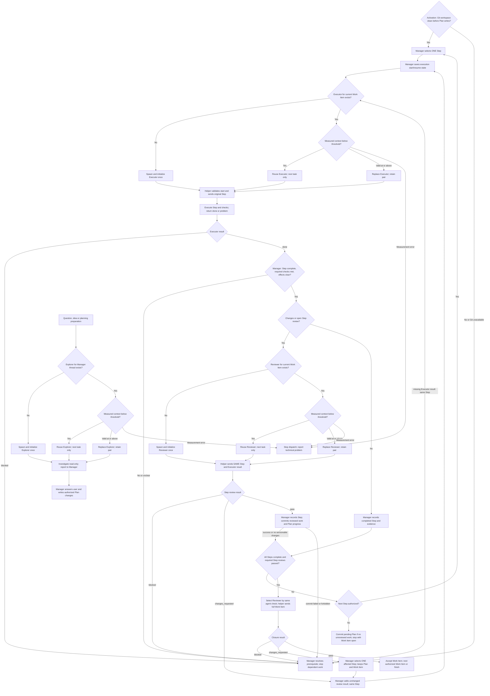

# Scoville Suite for Codex

Scoville helps Codex plan, implement and review work that spans more than one
conversation. Workflow runs the work step by step in the Plan's order, Ask
brings in independent advice, and Handoff carries unfinished tasks into the
next session. Setup manages the project's model and Workflow settings.

Scoville is the scale for chili heat. These Skills aim for sharper work and
less diluted context. Adding more instructions is easy. Keeping the useful
ones is the point.

Using Claude Code or another Agent Skills host? Take
[Scoville Suite](https://github.com/benjaminstelzer/scoville-suite).
On Codex desktop, take
[Scoville Suite for Codex](https://github.com/benjaminstelzer/scoville-suite-for-codex),
which adds Workflow, Ask and Setup.

| Skill | Purpose |
| --- | --- |
| [Workflow for Codex](#scoville-workflow-for-codex) | Runs a repository Plan through the visible manager, executor, reviewer and explorer agents. |
| [Code](#scoville-code) | Keeps implementation, risk assessment and checks focused on what you asked for. |
| [Plan](#scoville-plan) | Keeps longer work, decisions and progress easy to pick up again. |
| [UI](#scoville-ui) | Builds and checks interfaces with their framework and design system. |
| [Handoff](#scoville-handoff) | Passes unfinished work to another session. |
| [Ask for Codex](#scoville-ask-for-codex) | Asks the advisers you configured for an independent opinion. |
| [Setup](#scoville-setup) | Manages the selected project's Scoville settings. |
| [Project Context Cleanup](#scoville-project-context-cleanup) | Keeps requested project rules and index text clear without losing required context. |

## Scoville Workflow for Codex

Scoville Workflow takes a prepared Plan through implementation, independent
review and corrections. A manager assigns bounded work, executors implement it
and reviewers check the result. Progress stays in the Plan across sessions.

Use Plan and Ask to settle requirements and acceptance first, then assign the
whole Plan or a defined part. Workflow suits larger tasks and software you
intend to maintain. For a tiny fix, the coordination is usually more work
than the fix. Install it through the complete Codex Suite in Codex desktop.

Scoville measures chili heat. Workflow keeps the goal sharp as agents take
turns. Adding more cooks is only useful if dinner still arrives.

### How it works

The thread where Workflow starts is the manager. It maintains the Plan and
coordinates Explorer, Executor and Reviewer. It writes no source code.
The helper sends original Plan context and exactly one selected Step; the
manager does not rewrite the assignment. Agents choose relevant Skills themselves.



Executor and Reviewer stay associated with one Work Item; Explorer with the
manager thread. One threshold applies before all subagent assignments.
Fresh agents receive role, writing, shell-command and result rules once.
Reuse sends only the next task and its binding context and evidence; it does
not reload those rules or already loaded Skills. Codex supplies project rules.
The Reviewer retains both Step and closure policies from its first assignment.
Establish completion and idle state before measuring an associated agent.
No existing agent means first creation. A valid measurement below threshold means
reuse; at or above means replace with the retained pair. Replacement does not
reset the role's model choice. A missing measurement or execution blocker
returns a problem to manager, not an automatic replacement. An incompatible
newly selected model pair requires a new agent. Ongoing writes are not interrupted
for threshold checks. Host compaction continues the same assignments.

Use complete unchanged native finals for review and correction inputs. Missing
required change attribution blocks review; recover it through the same
Step and agent check, never through a Manager-composed substitute.
Git is required. Activation checks a clean worktree before Plan writes; it
does not automatically clean existing work. Each passed changed Step is committed
with Plan progress before advancing. Reviewers use Git status and diff HEAD;
closure uses the Work Item start commit. Make no empty commits.

Review each Step that changed files, configuration or behavior. A Step without
such changes is checked by the closure review. The manager checks completion,
required checks and clear effects using the complete result and reconciled
retained effects. Missing or unclear results are resolved first; `changes: none`
alone means only no file changes; Git and actual non-file or ignored-output
evidence determine effects. Step review covers changes of the
selected Step, necessary context and open findings. Follow-ups without new
changes do not end an open Step review or its findings; evidence-only follow-ups
continue review of the original change. The separate closure review
checks every Step and the full Acceptance against current implementation.
Corrections repeat one Step, its review when required, then closure when due. If no existing
Step covers a missing already required implementation, manager may add that
Step without changing Acceptance; changed or unclear requirements need the user.

### What it enforces

- **Responsibility.** The visible chat maintains the Plan; executors implement
  and reviewers assess. At most one executor writes in the shared checkout.
- **Bounded work.** Exactly one original Step is executed and reviewed before
  the next. Every Work Item also receives a full Step/Acceptance closure review.
- **Git.** Git and a clean worktree are required before activation Plan writes.
  The manager commits each passed changed Step with Plan progress before advancing.
- **Reuse.** Executor and Reviewer belong to the current Work Item; Explorer to
  the manager thread. A helper checks one shared threshold before assignments.
- **Model choices.** Configured executor, reviewer and explorer models and effort are respected.
  Unsupported settings stop dependent work rather than being substituted.
- **Continuity.** The same chat continues after compaction from concise Plan
  state, known child identities, completed effects and open decisions.
- **Visible decisions.** The manager asks necessary questions directly. Stops
  preserve unfinished work; completion requires accepted scope and quiescent writers.

Workflow activation includes accepted-Step commits, subject to explicit user
and project restrictions. It never cleans or commits preexisting work to start.
The [operations reference](https://github.com/benjaminstelzer/scoville-suite-for-codex/blob/main/packages/scoville-workflow-for-codex/scoville-workflow-for-codex/references/operations.md)
contains execution, review and stop behavior.

### What it costs

Executors, independent reviews and necessary corrections add tokens and time.
Reuse subagents below the shared threshold and keep checks proportional.
No typical overhead or saving has been measured.

[How to use Scoville Workflow for Codex](members/scoville-workflow-for-codex/README.md#how-to-use).

## Scoville Code

Passing tests are useful. Passing tests for the wrong behavior, rather less so.
Scoville Code keeps implementation, debugging and review tied to the result you
asked for: find the cause, work with the existing architecture and check what
actually changed.

Scoville measures chili heat. Code aims for sharper reasoning before a small
fix acquires its own framework.

### How it works

- Establish the requested result and find the code responsible for it.
- Fix the cause within the project's architecture and your authorized scope.
- Check the affected behavior and relevant performance costs.
- Reassess failed fixes, report remaining limits and stop when further checks
  would no longer change the decision.

### What it enforces

- **Work that serves the request.** Refactors, safeguards and tests need a
  concrete purpose. The agent asks about material choices and settles routine
  details from the project.
- **Your conventions.** Existing architecture and project rules take precedence.
  New projects start with a small structure organized by responsibility.
- **Evidence that fits the change.** Check the behavior, preserve guarantees and
  distinguish observed results from what remains unverified.

Keep personal conventions outside the installed Skill so updates preserve them.
See the [customization guide](https://github.com/benjaminstelzer/scoville-code#your-own-conventions)
and [full instructions](https://github.com/benjaminstelzer/scoville-code/blob/main/scoville-code/SKILL.md).

### What it costs

- Reading relevant code and checking behavior takes tokens and time. The extra work is aimed at avoiding fixes that merely look finished.

[How to use Scoville Code](members/scoville-code/README.md#how-to-use).

## Scoville Plan

Scoville Plan keeps goals, decisions and progress in the repository so longer
work survives the next conversation. You can see what is done, what remains
and why a choice was made without reconstructing it from chat history.

Use it for work with dependencies or several sessions. Settle the requirements
and acceptance criteria before implementation, get independent advice where
useful, and revise the Plan when the facts change. A contained fix can stay small.

Scoville measures chili heat. Plan keeps the direction from being diluted by
one more perfectly reasonable detour.

[Plan Viewer](https://github.com/benjaminstelzer/scoville-plan-viewer/releases/latest)
shows these records on Windows, macOS and Linux.

### How it works

- Use the repository's existing planning system and relevant Plan, Work Items and Decisions.
- Check current sources before starting the next item.
- Edit Markdown and YAML records with observed Step progress and any additional Instructions.
- Record concise acceptance results before completion and validate the records.

### What it enforces

- **Resumable work.** Goals, ordered Steps, dependencies and the current position
  stay explicit in the project's records.
- **Decisions with an owner.** Confirmed choices are recorded. Open questions
  remain proposals and block only the work that depends on them.
- **Evidence before completion.** Finished means acceptance was checked.
  Changes of direction preserve completed work, binding constraints and material decisions.

Edit records from one session at a time. Concurrent edits need reconciliation.
See the [full instructions](https://github.com/benjaminstelzer/scoville-plan/blob/main/scoville-plan/SKILL.md).

### What it costs

- Maintaining records takes tokens and time. It pays for continuity on dependent work. A small fix rarely needs a large Plan.

[How to use Scoville Plan](members/scoville-plan/README.md#how-to-use).

## Scoville UI

Scoville UI builds and audits interfaces with the project's framework and
design system. It covers clear wording, useful hierarchy, responsive layouts
and accessible interactions, then checks the rendered result. A tidy component
tree is a start. People still have to use the page.

It includes specific guidance for plugin-owned WordPress admin pages, using
Core components and WordPress conventions.

Scoville measures chili heat. UI aims for a sharper interface without making
the user sweat.

### How it works

- Establish the user's task, approved design direction and framework components.
- Build the affected views, wording, states and responsive behavior.
- Inspect the rendered interface and try its relevant interactions.
- Apply the WordPress adapter to supported plugin-owned admin pages. Editor
  surfaces and metaboxes keep their host's conventions.

### What it enforces

- **A coherent interface.** Hierarchy, controls and terminology follow the task
  and the existing design system.
- **Usable states.** Loading, empty, error and success states receive the same
  attention as the convenient example with perfect data.
- **Access across devices.** Check responsive layout, zoom, reading order,
  contrast, focus and keyboard or touch operation where applicable.
- **Rendered proof.** Source checks alone cannot establish that the interface
  works. Unchecked rendering or interaction stays explicitly unverified.

See the [full instructions](https://github.com/benjaminstelzer/scoville-ui/blob/main/scoville-ui/SKILL.md).

### What it costs

- Rendered inspection and interaction checks take tokens and time. They catch problems the source alone cannot show. WordPress tasks also load platform guidance.

[How to use Scoville UI](members/scoville-ui/README.md#how-to-use).

## Scoville Handoff

Scoville Handoff turns the current task into one copy-ready continuation
prompt: the goal, decisions, unfinished work, blockers and next action.
Another session can pick up the work without asking you to explain it all again.

Scoville measures chili heat. Handoff keeps the useful context from being
diluted between conversations. The next agent already has enough imagination.

### How it works

- Read the conversation and the task sources already named or established.
- Capture the facts needed to resume, including permissions and unfinished work.
- Produce one prompt in the requested language, otherwise the conversation
  language. The receiving agent checks current state before acting.

### What it enforces

- **Explicit transfer.** A handoff starts when you request one. Preparing it is
  read-only and does not advance the task.
- **Faithful context.** Decisions, permissions, ownership and blockers survive
  the transfer. Unknown results stay unknown, and secrets stay out.
- **A useful next action.** The prompt tells the next session where to resume
  and how to recognize completion.

A targeted GPT-6 Luna High test turned a preference into a requirement. Check
that distinction in a generated handoff. Later testing has not disproved the
observation.

See the [full instructions](https://github.com/benjaminstelzer/scoville-handoff/blob/main/scoville-handoff/SKILL.md).

### What it costs

- Preparing the prompt takes tokens and time once, so the next session has less context to reconstruct.

[How to use Scoville Handoff](members/scoville-handoff/README.md#how-to-use).

## Scoville Ask for Codex

Scoville Ask gets independent advice from the advisers you choose and returns
it to your current task. Use it for a patch review, a second opinion or a
comparison of approaches. Each adviser gets the question and relevant evidence
with fresh context.

Scoville measures chili heat. Ask adds a little heat to your assumptions.
Unanimous agreement is pleasant, but finding the missed problem is more useful.

### How it works

- Select configured advisers using native Codex agents or the Claude CLI.
- Give each the same question, scope and relevant evidence independently.
- Collect separate reviews or combine answers to a general question. Follow-up
  questions continue with the same adviser and context.
- Show missing answers and failed starts alongside completed results.

### What it enforces

- **Independent advice.** Advisers assess the work. Changes remain with the
  calling task. Native read-only behavior is instructed, not sandbox-enforced.
- **Traceable answers.** Results stay attached to their adviser and question.
- **Explicit failures.** Unavailable models, invalid settings and failed calls
  are reported. Ask does not quietly choose a different adviser.

Claude uses read tools by default. Web access requires `claude.web_tools`.

### What it costs

- Each adviser adds model usage, waiting and agent capacity. Use extra opinions for decisions worth checking. You still have to weigh disagreements.

[How to use Scoville Ask for Codex](members/scoville-ask-for-codex/README.md#how-to-use).

## Scoville Setup

Setup shows the Scoville settings your project actually uses and saves the
changes you request. Models, reasoning levels and Workflow settings stay in
one project file, with defaults filling the gaps.

Scoville measures chili heat. Setup lets you choose the seasoning instead of
discovering it halfway through the meal.

### How it works

- Read project settings from `.scoville/config.json`, using defaults for missing values.
- Validate requested changes with the same checks used by Ask and Workflow, then save them.

### What it enforces

- Saves settings only when you ask and leaves unrelated values alone.
- Rejects invalid values before writing.
- Changes configuration between runs. It doesn't start or supervise a
  workflow.

### What it costs

- Viewing or changing settings takes an agent interaction. Saved project settings spare you from repeating the same choices in later runs.

[How to use Scoville Setup](members/scoville-setup/README.md#how-to-use).

## Scoville Project Context Cleanup

Project rules grow. Unfortunately, clarity does not grow automatically with
them. This Skill adds or revises the rules you request in
`AGENTS.md` and
context in `PROJECT_INDEX.md`, keeping useful information where the next agent
will find it.

It preserves meaning, scope and safeguards. Suitable text stays as it is.

Scoville measures chili heat. Context Cleanup removes the dilution, not the
ingredients that made the rules useful.

### How it works

- Resolve the target file and read its relevant governing rules.
- Check the addition for useful project information, duplicates and conflicts.
- Place concise wording in the affected structure, with conditions and exceptions together.
- Inspect the saved change and use the record owner's checks where required.

### What it enforces

- Requested additions and cleanup stay within the named project-context files.
- Scope, conditions, permissions, safeguards and necessary reasons survive edits.
- Existing formats and record owners remain responsible for fields and lifecycle.
- Suitable text stays unchanged, and unresolved material choices are asked directly.

### What it costs

- Reading the rules and checking edits takes tokens and time. The useful return is clearer context for later work, without deleting necessary detail.

[How to use Scoville Project Context Cleanup](members/scoville-project-context-cleanup/README.md#how-to-use).

## Compatibility

Requires Codex desktop, native agents and Python 3.11+ (Claude consultations also need a signed-in Claude Code CLI, 2.1.280+ for Opus 5.5). Fable, Astra, SOL or Opus (5.0+) are recommended. Selected Luna 6 High checks in Codex are described in each Skill's Compatibility notes; they do not establish a suite-wide baseline.

## Install the suite

Install the suite once in your agent host and it's available in all your
projects. Workflow starts directly in a saved Codex project.

### New installation

Use this request in your agent host:

```text
Install and enable the complete suite for all my projects directly from https://github.com/benjaminstelzer/scoville-suite-for-codex.
```

Don't mix standalone and suite copies of the same Skill.

If your host can't install directly from GitHub, download this repository and
copy all the package directories inside it to the host's Skills folder. You
end up with the same complete suite and the same requirements.

<details>
<summary>Upgrade from an earlier Scoville or Ask suite</summary>

### Upgrade from an earlier Scoville or Ask suite

Use this request in your agent host:

```text
1. Uninstall the following Skills completely, including their settings, when present:
scoville-brainstorm, scoville-code-anti-ai-slop,
scoville-design-anti-ai-slop, scoville-handoff, scoville-plan,
scoville-research, scoville-scribe-anti-ai-slop,
scoville-ui-anti-ai-slop, scoville-wordpress-ui-backend-anti-ai-slop,
scoville-workflow-for-codex, scoville-workflow-codex,
ask-astra-for-review-for-codex, ask-sol-for-review-for-codex,
ask-claude-for-codex, ask-claude-and-astra-for-codex,
ask-claude-and-sol-for-codex.
Skip absent entries, leave unrelated Skills untouched, and keep no backup or settings migration.
2. Install and enable the complete suite for all my projects directly from https://github.com/benjaminstelzer/scoville-suite-for-codex.
```

</details>


## Configuration

Use Scoville Setup to view or save model choices and Workflow settings in
`.scoville/config.json`. Missing values use the bundled defaults. See the
[Workflow configuration](members/scoville-workflow-for-codex/README.md#configuration)
and [Ask configuration](members/scoville-ask-for-codex/README.md#configuration)
for their settings.

## Limitations

### Agent capacity

Codex retains native agent threads from earlier assignments, so longer
Workflow runs and Ask consultations can reach the host's agent limit.
To give these runs more room, raise the limit to 256 in
`~/.codex/config.toml` under `[agents]`. Add the section if it is missing:

```toml
[agents]
max_concurrent_threads_per_session = 256
```

This is the suite's recommendation for longer runs. The
[Codex configuration reference](https://learn.chatgpt.com/docs/config-file/config-reference)
describes the setting. If a start or necessary message still fails, the
affected operation stops and reports the problem with its progress preserved
for continuation.


## Developer links

<details>
<summary>Development and builds</summary>

Sources live under `members/`. Edit README fragments in `development/readme/`,
then run `python development/build_suite.py --write-readmes`. The manifest
`suite.json` owns package membership and README composition.

[Development notes](https://github.com/benjaminstelzer/scoville-suite-for-codex/blob/main/docs/README.md)
explain the problems behind the suite. The
[build guide](development/shared/build/fragments.md) covers package generation,
runtime checks and Skill publication integrity. Installed Skills need only their own packages.

</details>

Sources, tests and notes live in this suite. Individual packages leave out
this block and the development files.

- **scoville-code**: [Source](https://github.com/benjaminstelzer/scoville-suite-for-codex/tree/main/members/scoville-code) | [Tests](https://github.com/benjaminstelzer/scoville-suite-for-codex/tree/main/members/scoville-code/development/tests) | [Notes](https://github.com/benjaminstelzer/scoville-suite-for-codex/blob/main/members/scoville-code/development/README.md)
- **scoville-plan**: [Source](https://github.com/benjaminstelzer/scoville-suite-for-codex/tree/main/members/scoville-plan) | [Tests](https://github.com/benjaminstelzer/scoville-suite-for-codex/tree/main/members/scoville-plan/development/tests) | [Notes](https://github.com/benjaminstelzer/scoville-suite-for-codex/blob/main/members/scoville-plan/development/README.md)
- **scoville-ui**: [Source](https://github.com/benjaminstelzer/scoville-suite-for-codex/tree/main/members/scoville-ui) | [Tests](https://github.com/benjaminstelzer/scoville-suite-for-codex/tree/main/development/instruction_tests) | [Notes](https://github.com/benjaminstelzer/scoville-suite-for-codex/blob/main/members/scoville-ui/development/README.md)
- **scoville-handoff**: [Source](https://github.com/benjaminstelzer/scoville-suite-for-codex/tree/main/members/scoville-handoff) | [Tests](https://github.com/benjaminstelzer/scoville-suite-for-codex/tree/main/members/scoville-handoff/development/tests) | [Notes](https://github.com/benjaminstelzer/scoville-suite-for-codex/blob/main/members/scoville-handoff/development/README.md)
- **scoville-workflow-for-codex**: [Source](https://github.com/benjaminstelzer/scoville-suite-for-codex/tree/main/members/scoville-workflow-for-codex) | [Tests](https://github.com/benjaminstelzer/scoville-suite-for-codex/tree/main/members/scoville-workflow-for-codex/development/tests) | [Notes](https://github.com/benjaminstelzer/scoville-suite-for-codex/blob/main/members/scoville-workflow-for-codex/development/README.md)
- **scoville-ask-for-codex**: [Source](https://github.com/benjaminstelzer/scoville-suite-for-codex/tree/main/members/scoville-ask-for-codex) | [Tests](https://github.com/benjaminstelzer/scoville-suite-for-codex/tree/main/members/scoville-ask-for-codex/development/tests) | [Notes](https://github.com/benjaminstelzer/scoville-suite-for-codex/blob/main/members/scoville-ask-for-codex/development/README.md)
- **scoville-setup**: [Source](https://github.com/benjaminstelzer/scoville-suite-for-codex/tree/main/members/scoville-setup) | [Tests](https://github.com/benjaminstelzer/scoville-suite-for-codex/tree/main/members/scoville-setup/development/tests) | [Notes](https://github.com/benjaminstelzer/scoville-suite-for-codex/blob/main/members/scoville-setup/development/README.md)
- **scoville-project-context-cleanup**: [Source](https://github.com/benjaminstelzer/scoville-suite-for-codex/tree/main/members/scoville-project-context-cleanup) | [Tests](https://github.com/benjaminstelzer/scoville-suite-for-codex/tree/main/development/instruction_tests) | [Notes](https://github.com/benjaminstelzer/scoville-suite-for-codex/blob/main/members/scoville-project-context-cleanup/development/README.md)

## License

The bundled Skills use the MIT license. Each package includes its `LICENSE` file.

