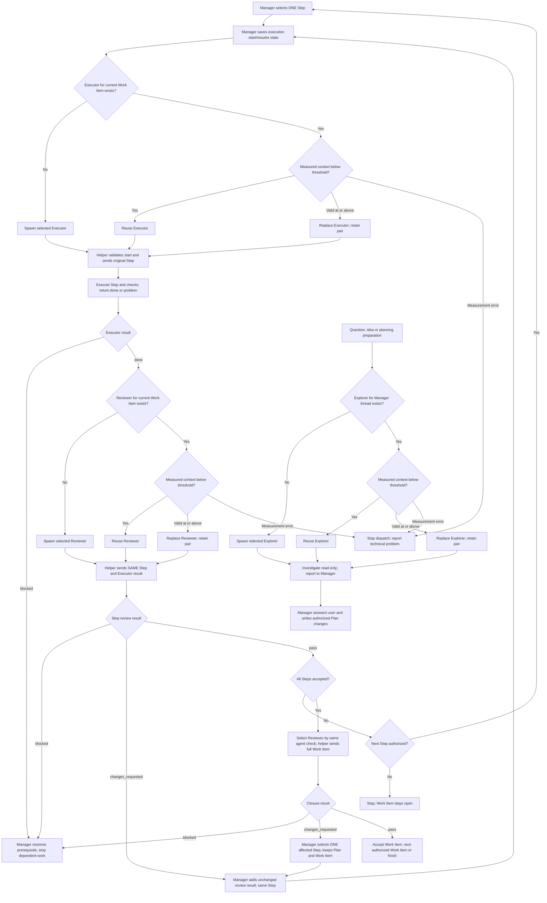

## How it works

The thread where Workflow starts is the manager. It maintains the Plan and
coordinates Explorer, Executor and Reviewer. It writes no source code.
The helper sends original Plan context and exactly one selected Step; the
manager does not rewrite the assignment. Agents choose relevant Skills themselves.

Executor and Reviewer stay associated with one Work Item; Explorer with the
manager thread. One threshold applies before all subagent assignments.
Establish completion and idle state before measuring an associated agent.
No existing agent means first creation. A valid measurement below threshold means
reuse; at or above means replace with the retained pair. Replacement does not
reset the role's model choice. A missing measurement or execution blocker
returns a problem to manager, not an automatic replacement. An incompatible
newly selected model pair requires a new agent. Ongoing writes are not interrupted
for threshold checks. Host compaction continues the same assignments.

Use complete unchanged native finals for review and correction inputs. Missing
required before/after attribution blocks review; recover it through the same
Step and agent check, never through a Manager-composed substitute.

Every Step gets independent review. It covers actual changes of the selected
Executor assignment, necessary context and open findings. An evidence-only
follow-up continues review of the original change. The separate closure review
checks every Step and the full Acceptance against current implementation.
Corrections repeat one Step and its review, then closure when due. If no existing
Step covers a missing already required implementation, manager may add that
Step without changing Acceptance; changed or unclear requirements need the user.
