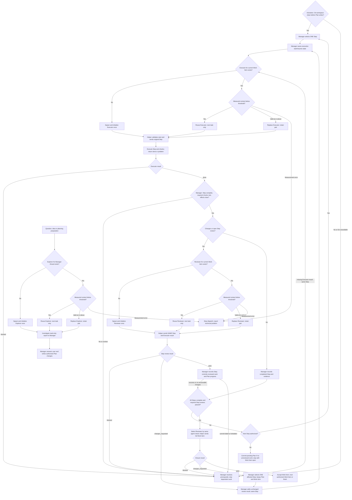

## How it works

The thread where Workflow starts is the manager. It maintains the Plan and
coordinates Explorer, Executor and Reviewer. It writes no source code.
The helper sends original Plan context and exactly one selected Step; the
manager does not rewrite the assignment. Agents choose relevant Skills themselves.

Executor and Reviewer stay associated with one Work Item; Explorer with the
manager thread. One threshold applies before all subagent assignments.
Fresh agents receive role, writing, shell-command and result rules once.
Reuse sends only the next task and its binding context and evidence; it does
not reload those rules or already loaded Skills. Codex supplies project rules.
The Reviewer retains both Step and closure policies from its first assignment.
Establish completion and idle state before measuring an associated agent.
No existing agent means first creation. A valid measurement below threshold means
reuse; at or above means replace with the retained pair. Replacement does not
reset the role's model choice. A missing measurement or execution blocker
returns a problem to manager, not an automatic replacement. An incompatible
newly selected model pair requires a new agent. Ongoing writes are not interrupted
for threshold checks. Host compaction continues the same assignments.

Use complete unchanged native finals for review and correction inputs. Missing
required change attribution blocks review; recover it through the same
Step and agent check, never through a Manager-composed substitute.
Git is required. Activation checks a clean worktree before Plan writes; it
does not automatically clean existing work. Each passed changed Step is committed
with Plan progress before advancing. Reviewers use Git status and diff HEAD;
closure uses the Work Item start commit. Make no empty commits.

Review each Step that changed files, configuration or behavior. A Step without
such changes is checked by the closure review. The manager checks completion,
required checks and clear effects using the complete result and reconciled
retained effects. Missing or unclear results are resolved first; `changes: none`
alone means only no file changes; Git and actual non-file or ignored-output
evidence determine effects. Step review covers changes of the
selected Step, necessary context and open findings. Follow-ups without new
changes do not end an open Step review or its findings; evidence-only follow-ups
continue review of the original change. The separate closure review
checks every Step and the full Acceptance against current implementation.
Corrections repeat one Step, its review when required, then closure when due. If no existing
Step covers a missing already required implementation, manager may add that
Step without changing Acceptance; changed or unclear requirements need the user.
