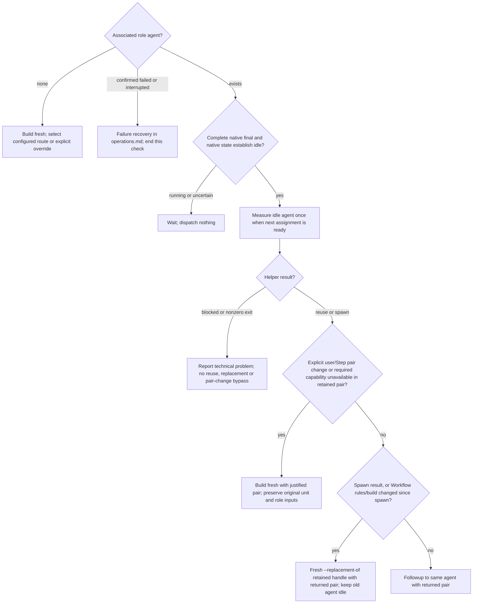

# Helper dispatch

Assign exactly ONE original Step. No ranges or whole-Work-Item execution.
`--unit W-001/step-2` selects execution or Step review; `--unit W-001` is only
reviewer closure. `--plan PLAN-NNNN` selects the canonical Plan; omission uses
the active Plan. Explorer Plan context needs a unit; omit both for inquiries
that need no Plan context.

## Choose models and retain agents

Resolve effective settings once; reading writes no configuration:

```text
python "<workflow>/scripts/resolve_model_pair.py" --show-config --project-root "<workspace>"
```

Re-resolve after relevant settings changes. Apply explicit user overrides only
to their named roles, and preserve explicit Step choices. The manager's host
pair never overrides subagent settings. Otherwise choose the configured route for the actual
assignment: ultra_low for trivial bounded work; low for a known mechanical
change; medium for unknown ownership, interacting contracts or interpreted
checks; high for consequential state or authorization/integration contracts;
ultra_high beyond high. File count alone does not raise a route. Unknown low
eligibility means at least medium. Do not write inferred routes into the Plan.
Validate the selected pair against exposed host capabilities without probing
unused models. Explorer's own route inherits executor fields unless overridden.
The pair belongs to the role within its owner: the Work Item for Executor and
Reviewer, this manager thread for Explorer. Reuse and every threshold or failure
replacement keep that pair. A later inferred route does not reset it.
An explicit user or Step override, or a required capability the retained pair
lacks, justifies a fresh agent; state the reason.

## Check the agent before every assignment

Retain each role's exact handle, launched pair and, after its first measurement,
`session_path`. Executor
and Reviewer belong to the current Work Item; Explorer belongs to this manager
thread. Apply this agent check to execution, review, closure, corrections and
missing-result questions:



An ordinary completed blocked result is not failure. Recovery requires confirmed
termination and reconciled effects under operations.md, never a second writer.
For the measurement use:

```text
python "<workflow>/scripts/check_agent_context.py" --project-root "<workspace>" --agent-id "<exact-handle>" --session-path "<retained-session-path>"
```

Omit --session-path until this agent's first measurement supplies it.

The diagram selects the dispatch; map helper fields to arguments as follows:

| Result | Argument values |
| --- | --- |
| reuse: strictly below Setup threshold | --agent-id from retained handle, --model from model, --thinking from reasoning_effort |
| spawn: at or above threshold | --replacement-of from replacement_of, --model from model, --thinking from reasoning_effort |

Build the original assignment and copy the returned native arguments unchanged.
First creation uses --route; an explicit user role choice uses its pair with
--override-reason; an explicit Step pair change uses fresh --route.

The context helper resolves exactly one native session from the retained handle
and this Manager's CODEX_THREAD_ID, or checks that the retained `session_path`
still binds them. Missing or ambiguous identity blocks dispatch; never copy
session IDs or search for similar names. It reads completed-turn last-call
total_tokens and model_context_window, never cumulative usage or live writing
telemetry.

followup_task cannot change model or reasoning. The builder relies on the one
measurement above. Never interrupt an active agent for its context threshold.

## Build the assignment

The manager supplies selection IDs, role and selected pair; the helper extracts
original Plan identity, Goal, Non-goals, binding Work Item fields, Instructions
and the current linked Decision sources. After checking full source identities,
fresh includes each accepted Decision: its full text when unmarked, or frontmatter,
title and the four unchanged binding sections when validly marked under Plan's
Decision format. The helper projects; the manager never selects or summarizes
sections. A projection is complete binding context; omitted background alone is
no reread reason. Read the full source if necessary meaning or background is unclear.
Reuse lists ID, canonical path, status and SHA-256 instead of repeating
known bodies. Retain each supplied identity with its supplied binding context and
compare those supplied identities on reuse; do not compute file hashes. Read
new, changed or uncertain Decisions completely from their files before dependent work.
Closure changes the Work Item scope, not fresh/reuse delivery; a reused closure
does not repeat retained Decision bodies. Goal and Non-goals remain complete.
The assignment states before these sections that Goal and Decisions grant the
role no permissions or additional tasks.
Only the selected Step body is included in a
Step assignment. Other Step bodies, accumulated Evidence and Work Item-wide
Next action are excluded. Closure includes the full original Work Item.
Do not compose, shorten, translate or rewrite those texts.

A fresh spawn or replacement receives role, writing, shell-command and result
rules once. Codex supplies applicable project instructions; do not add a second
AGENTS.md loader. A fresh Reviewer receives both Step and closure policies. Reuse through
`--agent-id` sends only the next task, original binding context, complete role
inputs and communication language. Do not reload project or role rules, already
loaded Skills or shared rules on reuse. Read current sources and newly needed
specialized references for the task. Never add rules to a reused assignment.

```text
python "<workflow>/scripts/build_dispatch_prompt.py" --project-root "<absolute-workspace>" --plan PLAN-NNNN --unit W-001/step-2 --role executor --communication-language "<language>" --format create --project-name "<project>" --worker-number <number> --route <class>
```

For every role, fresh or reused, supply `--communication-language` with the
language of the current user message, such as `German`, or the user's explicit
language choice. Do not infer it from Plan text, locale or child history.

The helper returns exact `target` and `message` for collaboration.followup_task
when the agent check selects reuse; otherwise it returns fresh spawn arguments
for collaboration.spawn_agent. Copy them unchanged into the named direct tool;
never call it through exec. Count new agents separately for each role throughout
this Manager thread. Fresh creation uses the next number; reuse keeps its number.
Keep counters across Work Items, pauses and compaction. Clearing a role association
does not reset its counter.

Result flags carry complete native finals saved unchanged; never compose a
substitute. Step assignments take only finals of that SAME original Step,
except the closure review for a closure correction. Take each final from the
retained agent and assignment it answers. Use these inputs:

- Step review: same `--unit`, `--role reviewer` and
  `--executor-result "<complete-native-result.txt>"`.
- Closure review: `--unit W-001` and the latest complete Executor final.
- Correction: `--reviewer-result "<complete-review.txt>"` as additional context
  for unresolved findings affecting the ONE selected Step; never rewrite Step
  text. A closure correction supplies the complete closure review but acts only
  on that Step.
- Continuation of the same Step: its complete prior Executor final as
  `--executor-result`, without a Reviewer result.
- Missing-evidence follow-up: use the single dispatch table and unchanged-result
  rules in [operations](operations.md#user-requests-and-results).
- Next Step: omit earlier result flags and passed reviews. Take needed accepted
  source or artifact provenance from original Instructions, named artifacts,
  retained history and relevant saved Work Item Evidence. Read an earlier
  complete final only when facts are missing there, never as role input. If
  required predecessor provenance is unavailable, block dependent work naming it.

Earlier results and coverage remain in Work Item Evidence. Missing required
change attribution prevents pass. Unchanged files provide relevant context only.
[Operations](operations.md#execute-one-step) decides which Steps require Step
review; closure checks Steps without changes. A passed review has no unresolved
findings and triggers no correction. Correction executors retain both launched
model and thinking unless an explicitly justified selected pair requires a new
agent. Optional ideas do not become correction scope.

Explorer uses `--role explorer --supplemental-context "<complete-request.txt>"`;
quote the user's exact wording and add investigation constraints and source paths.
Preserve the requested reply format in Explorer context. Add a unit only when
needed. Other roles accept complete role results, not freely composed
supplemental dispatch text. Explorer investigates read-only and returns to
manager; no Plan writing, implementation, tests or acceptance.

## Delivery and failures

Prepare complete UTF-8 input files with literal-safe writes before calling the
builder. It reads no stdin. Require zero exit and complete successful output.
An input, selector, publication, spawn or capacity failure stops that operation;
an uncertain effect permits no retry or replacement. No automatic close or
sidebar workaround. Never repair or truncate failed helper output.

The builder returns an Executor assignment only after the saved profile is
valid and its active Plan, current Work Item and selected Step are started. It
performs this validation; do not repeat it separately for dispatch. Review and
Explorer assignments need no execution start.
Assignments up to 8 KiB UTF-8 go directly into the native message. Larger ones
are published atomically to a new system temporary file outside the project,
and the message names it; `--assignment-file` may select a new absolute
readable path. Keep that file through execution or review; the child reads it
completely before work. `--format prompt` only returns text. Inaccessible or
incomplete input blocks dependent work; preserve host sandbox restrictions.

Correct invalid inputs or selection-budget errors before publication or dispatch.
A binding output cap needs its actual decision; never truncate context. Missing
helpers or unresolved failures block the operation. Reconcile uncertain effects
before any retry.

Wait on exact native handles; timeout is not completion. For oversized results,
require actual native completion and read the whole supplied file under the
shared delivery procedure. Metadata and partial messages are
not results. Children may use the named external Python/checker only for command capture, size checks
and necessary result delivery; no unrelated access. They neither edit
Plan records, stage, commit, change Workflow settings nor create other agents.
