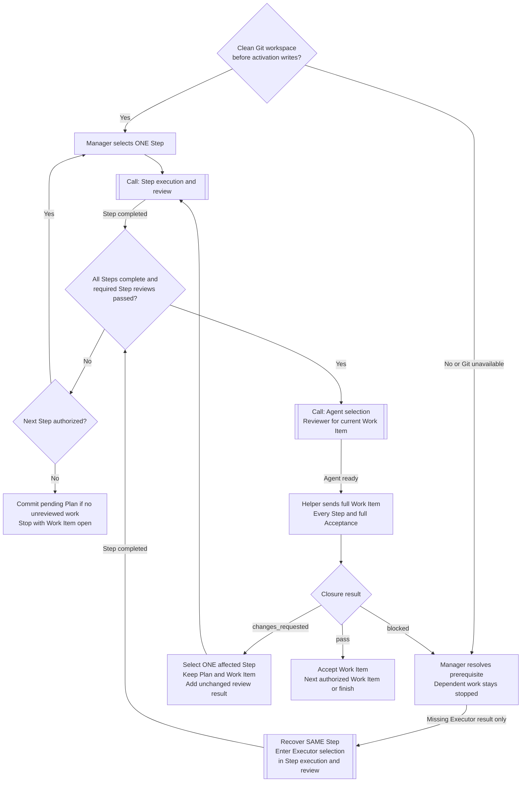
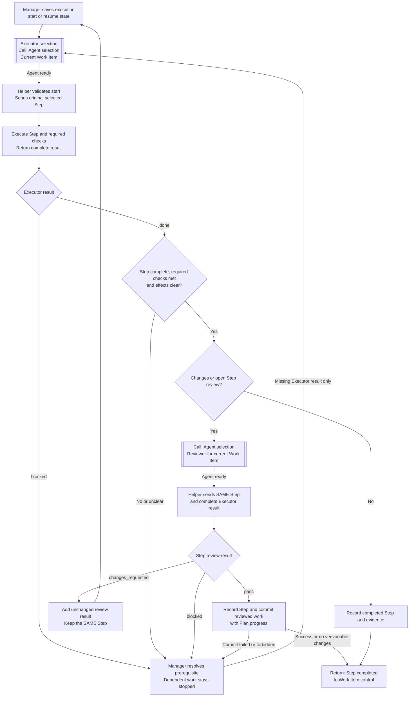
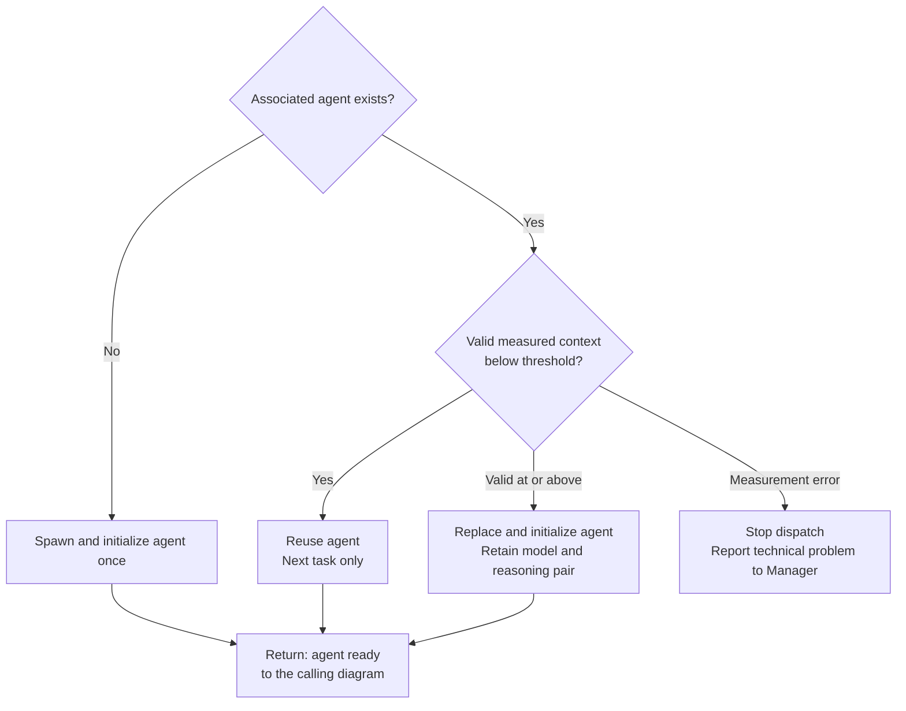
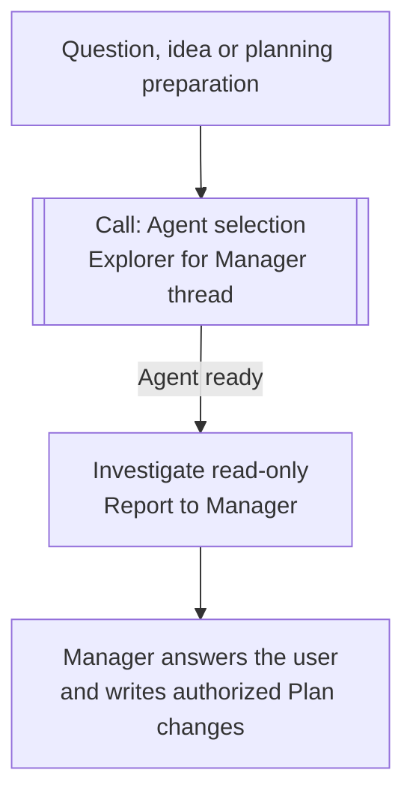

# Scoville Workflow for Codex

Scoville Workflow takes a prepared Plan through implementation, independent
review and corrections. A manager assigns bounded work, executors implement it
and reviewers check the result. Progress stays in the Plan across sessions.

Use Plan and Ask to settle requirements and acceptance first, then assign the
whole Plan or a defined part. Workflow suits larger tasks and software you
intend to maintain. For a tiny fix, the coordination is usually more work
than the fix. Install it through the complete Codex Suite in Codex desktop.

Scoville measures chili heat. Workflow keeps the goal sharp as agents take
turns. Adding more cooks is only useful if dinner still arrives.

## How it works

The thread where Workflow starts is the manager. It maintains the Plan and
coordinates Explorer, Executor and Reviewer. It writes no source code.
The helper sends original Plan context and exactly one selected Step; the
manager does not rewrite the assignment. Agents choose relevant Skills themselves.

Each named call continues in the diagram with that title. Agent selection returns
to its caller only when an agent is ready. A measurement error stops dispatch.

### Work Item control



### Step execution and review



### Agent selection

This check serves Executor, Reviewer and Explorer, including closure review.
Measure only after the associated agent has completed its work and is idle.



### Explorer requests



Executor and Reviewer stay associated with one Work Item; Explorer with the
manager thread. One threshold applies before all subagent assignments.
Fresh agents receive role, writing, shell-command and result rules once.
Reuse sends only the next task and its binding context and evidence; it does
not reload those rules or already loaded Skills. Codex supplies project rules.
The Reviewer retains both Step and closure policies from its first assignment.
Establish completion and idle state before measuring an associated agent.
No existing agent means first creation. A valid measurement below threshold means
reuse; at or above means replace with the retained pair. Replacement does not
reset the role's model choice. A missing measurement or execution blocker
returns a problem to manager, not an automatic replacement. An incompatible
newly selected model pair requires a new agent. Ongoing writes are not interrupted
for threshold checks. Host compaction continues the same assignments.

Use complete unchanged native finals for review and correction inputs. Missing
required change attribution blocks review; recover it through the same
Step and agent check, never through a Manager-composed substitute.
Git is required. Activation checks a clean worktree before Plan writes; it
does not automatically clean existing work. Each passed changed Step is committed
with Plan progress before advancing. Reviewers use Git status and diff HEAD;
closure uses the Work Item start commit. Make no empty commits.

Review each Step that changed files, configuration or behavior. A Step without
such changes is checked by the closure review. The manager checks completion,
required checks and clear effects using the complete result and reconciled
retained effects. Missing or unclear results are resolved first; `changes: none`
alone means only no file changes; Git and actual non-file or ignored-output
evidence determine effects. Step review covers changes of the
selected Step, necessary context and open findings. Follow-ups without new
changes do not end an open Step review or its findings; evidence-only follow-ups
continue review of the original change. The separate closure review
checks every Step and the full Acceptance against current implementation.
Corrections repeat one Step, its review when required, then closure when due. If no existing
Step covers a missing already required implementation, manager may add that
Step without changing Acceptance; changed or unclear requirements need the user.

## What it enforces

- **Responsibility.** The visible chat maintains the Plan; executors implement
  and reviewers assess. At most one executor writes in the shared checkout.
- **Bounded work.** Exactly one original Step is executed and reviewed before
  the next. Every Work Item also receives a full Step/Acceptance closure review.
- **Git.** Git and a clean worktree are required before activation Plan writes.
  The manager commits each passed changed Step with Plan progress before advancing.
- **Reuse.** Executor and Reviewer belong to the current Work Item; Explorer to
  the manager thread. A helper checks one shared threshold before assignments.
- **Model choices.** Configured executor, reviewer and explorer models and effort are respected.
  Unsupported settings stop dependent work rather than being substituted.
- **Continuity.** The same chat continues after compaction from concise Plan
  state, known child identities, completed effects and open decisions.
- **Visible decisions.** The manager asks necessary questions directly. Stops
  preserve unfinished work; completion requires accepted scope and quiescent writers.

Workflow activation includes accepted-Step commits, subject to explicit user
and project restrictions. It never cleans or commits preexisting work to start.
The [operations reference](https://github.com/benjaminstelzer/scoville-suite-for-codex/blob/main/packages/scoville-workflow-for-codex/scoville-workflow-for-codex/references/operations.md)
contains execution, review and stop behavior.

## What it costs

Executors, independent reviews and necessary corrections add tokens and time.
Reuse subagents below the shared threshold and keep checks proportional.
No typical overhead or saving has been measured.

## How it was developed

Earlier versions coordinated separate managers and context handoffs. The current
workflow keeps management in the visible chat and assigns bounded work directly.
Plan progress preserves completed effects, open reviews and decisions through
host compaction. Executors and reviewers load relevant Skills independently.

## Compatibility

Requires the Codex Suite, Git with a clean worktree at activation, Python 3.11+
and native agent tools in a shared workspace. Earlier Luna 6/high checks covered the former manager/handoff
architecture. They do not establish acceptance of the current direct manager,
complete workflows or other model routes and hosts. Current acceptance requires
new isolated native execution, review, continuation and stop checks.

## Install

Install and enable every Skill in the suite. Each applies to its own task scope.

Use the packages from
[Scoville Suite for Codex](https://github.com/benjaminstelzer/scoville-suite-for-codex/tree/main/packages).
Workflow only comes with the suite, and every Skill has to come from this
repository's own `packages/<name>/<name>/` directory. Don't swap in packages
from the individual repositories, and don't continue if members are missing.
Use the suite's prompt for a new installation, or its upgrade prompt if you
already have one installed.


## Configuration

Use Scoville Setup to show or save `.scoville/config.json` in the project.
`workflow.execute.CLASS`, `review.CLASS` and `explore.CLASS` select role models
and reasoning. Unspecified Explorer fields inherit effective Executor values.
The host chooses the manager model. Reads create no file.

`workflow.context_threshold_percent` is the one threshold for all subagents.
Its bundled default is 45. Reuse an idle associated agent below it; start a new
one at or above it. Check only before assignments. A failed measurement is a
technical problem, not a spawn fallback. There is no manager threshold or rollover.

Legacy `manager`, nested `context` and `pin_threads` settings are ignored on
reads and removed only by an authorized save. They do not configure this new
threshold. Other saved settings are preserved.

The [dispatch rules](scoville-workflow-for-codex/references/operations-dispatch.md)
explain model selection, original-text extraction and reuse.

## Limitations

### Agent capacity

Codex retains native agent threads from earlier assignments, so longer
Workflow runs and Ask consultations can reach the host's agent limit.
To give these runs more room, raise the limit to 256 in
`~/.codex/config.toml` under `[agents]`. Add the section if it is missing:

```toml
[agents]
max_concurrent_threads_per_session = 256
```

This is the suite's recommendation for longer runs. The
[Codex configuration reference](https://learn.chatgpt.com/docs/config-file/config-reference)
describes the setting. If a start or necessary message still fails, the
affected operation stops and reports the problem with its progress preserved
for continuation.

## How to use

With the suite installed in Codex, activate Workflow in this saved project:

```text
Use $scoville-workflow-for-codex to execute the active Scoville Plan in this saved project.
```

Name a Work Item or stopping point to limit scope. Otherwise the visible manager
executes the active Plan. Ask questions or stop during execution. Changed work
positions are brief; decisions go directly to you. Durable progress, unresolved
questions and evidence stay in the Plan. Stops and blockers are not completion.
Questions, change requests and planning preparation go to a read-only Explorer.
The manager returns its findings, writes the Plan and keeps implementation within authorized scope.

"Start Scoville Workflow" also activates it. "Execute the Plan" alone does not.

All roles communicate in the language of your current message unless you request
another language. Required field names and technical literals stay unchanged;
Plans follow Plan's record-language rules.

## Sources

- [Agent Skills specification](https://agentskills.io/specification) for the
  portable package and progressive disclosure model.
- [OpenAI coding-agent best practices](https://developers.openai.com/codex/learn/best-practices)
  for explicit outcomes, constraints, planning, and completion evidence.

## License

MIT. See [LICENSE](LICENSE).
